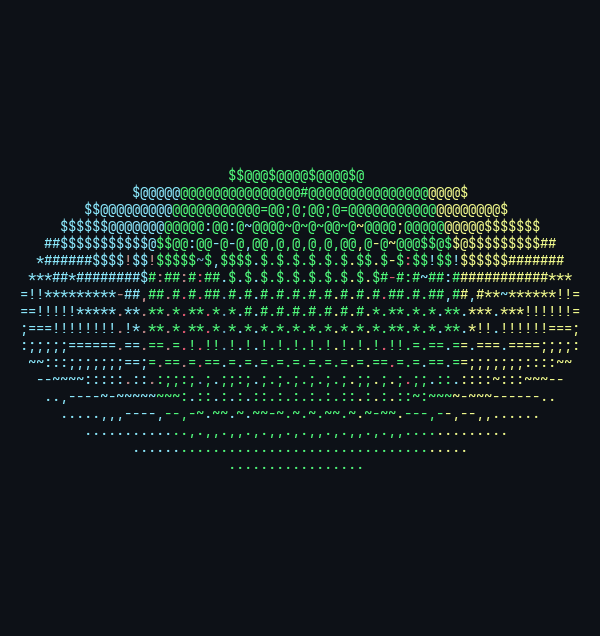

# Donut Renderer

A 3D renderer that draws spinning objects as ASCII art in the terminal, written from scratch in Python and NumPy. It's a linear-algebra refresher, inspired by the classic spinning ASCII donut.



## How it works

1. **Surface sampling:** each shape is a parametric surface (or an imported `.obj` mesh) sampled into points with surface normals.
2. **Rotation:** points and normals are rotated every frame with rotation matrices `Rz · Ry · Rx`.
3. **Perspective projection:** `x' = d·x / (z + d_obj)` maps 3D points onto the terminal, corrected for non-square character cells.
4. **Z-buffer:** only the nearest point is drawn in each character cell.
5. **Shading:** diffuse lighting (`normal · light`) picks a character from `.,-~:;=!*#$@`.

## Features

- Shapes: torus, disk, plane, tetrahedron, icosahedron, or any `.obj` file (auto-centred and auto-scaled)
- Solid ANSI colours or patterns: `rainbow`, `lifebuoy`, `swedish`, `funny_donut`
- Resizes with the terminal

## Run

```bash
pip install -r requirements.txt
python donut_renderer.py
```

Pick the shape and colour at the bottom of `donut_renderer.py`:

```python
renderer = Renderer(terminal_correction=0.5, object_size=1, object_type="torus")
renderer.run(colour_appearance="rainbow")
```
